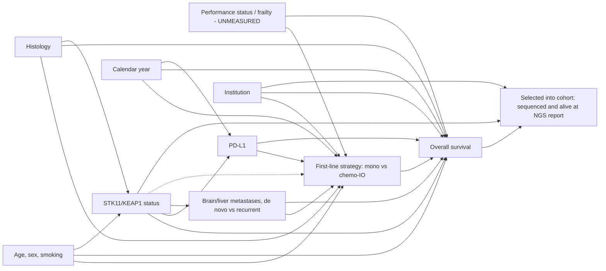

# DAG and identification assumptions (v0.1)

Assumptions needed for a causal reading of Δ(m,τ) and I(τ):
1. **Conditional exchangeability within biomarker strata** given age, sex, race, site, histology, smoking, PD-L1, metastatic sites, de novo status, prior systemic therapy, KRAS, TP53 and calendar year. Violated to an unknown degree by unmeasured performance status. For the *interaction*, bias cancels only if unmeasured confounding is equally strong in both biomarker strata — not guaranteed, because altered tumours are more aggressive.
2. **Positivity**: both strategies used at every covariate pattern in both strata; threatened by calendar time (no chemo-IO before 2017) and PD-L1 (<1% rarely gets monotherapy).
3. **Consistency**: strategies are heterogeneous (different agents and chemotherapy partners).
4. **No selection bias from cohort entry**: handled by requiring NGS before time zero (primary) or delayed-entry risk sets (sensitivity); selection on being sequenced at all remains and limits transportability.
5. **Non-informative censoring** given arm and biomarker.
6. **Biomarker measured without differential error** across arms (panel and site differences adjusted through institution).
PD-L1 and metastatic sites are downstream of the biomarker; adjusting for them is correct for confounding of treatment but means Δ is standardised to each stratum's own covariate distribution.
